# Warden's threat model

What can go wrong with Warden's security, who might make it go wrong, and how each threat is met. It's written
before Warden receives anyone's Agent events, so what Warden protects is decided, not discovered. What Warden
stores, for how long and where it goes is in [`data.md`](data.md).

**Built or designed.** Every threat row says which. **Built** means the mitigation exists in code with a test, and
names the slice that built it. **Designed** means it's decided but not built yet, and names the spec that will
build it. A designed row is a plan, not a guarantee. Slices are the foundation spec's (#1): slice 1a is #4, slice 2
is this document. The Guard, Patch and Vouch specs come after the foundation.

Where this document and an ADR disagree, the ADR wins.

## Method

[STRIDE](https://learn.microsoft.com/en-us/azure/security/develop/threat-modeling-tool-threats), applied at each
trust boundary:

- **S, Spoofing:** can someone pretend to be another person, Team or service?
- **T, Tampering:** can someone change data or code they shouldn't?
- **R, Repudiation:** can someone deny what they did, for lack of a record?
- **I, Information disclosure:** can someone read what they shouldn't?
- **D, Denial of service:** can someone stop Warden working, or run up its bill?
- **E, Elevation of privilege:** can someone do more than their Role or credential allows?

## The system on one page

Each box named TB1 to TB9 is a trust boundary: whatever crosses its edge is checked on the way in.

```mermaid
flowchart LR
  subgraph TB1["TB1: the person's browser"]
    UI["Dashboard"]
  end

  subgraph TB5["TB5: the developer's laptop"]
    CC["Claude Code"]
    MH["Managed hook settings, with the Team's hook token"]
    SA["safeagents scrub, where present"]
    CC --> MH
    MH --> SA
  end

  subgraph GCP["Warden's GCP project, europe-west1"]
    subgraph TB2["TB2: the API on Cloud Run"]
      API["API: Clerk session and Role checks"]
      HOOK["Hook endpoint: token, limits, redact on arrival"]
      WH["GitHub webhook receiver: signature check"]
      JUDGE["Judge: a Spot run"]
    end
    subgraph TB3["TB3: the database, through withTeam"]
      DB[("Cloud SQL Postgres, row-level security")]
    end
    subgraph TB4["TB4: Secret Manager"]
      SM["Clerk keys, database passwords, GitHub app key and webhook secret, OpenRouter key, Langfuse keys, pseudonym keys"]
    end
    LOG["Cloud Logging, through the redactor"]
  end

  subgraph TB6["TB6: GitHub, through the GitHub app"]
    GH["The Team's repos"]
  end

  subgraph TB7["TB7: the Judge calling OpenRouter"]
    OR["OpenRouter and its providers, ZDR only"]
  end

  subgraph TB8["TB8: Langfuse Cloud"]
    LF["Traces of Warden's model calls, metadata only"]
  end

  subgraph TB9["TB9: CI and the release from main"]
    CI["GitHub Actions: fast lane, release from main"]
  end

  CLERK["Clerk: identity and Clerk Organizations"]

  UI -->|"HTTPS, Clerk session token"| API
  UI -->|"sign-in"| CLERK
  API -->|"verify session"| CLERK
  SA -->|"HTTPS POST, hook token in a header"| HOOK
  API -->|"withTeam"| DB
  HOOK -->|"withTeam"| DB
  JUDGE -->|"withTeam"| DB
  WH -->|"withTeam"| DB
  API --> SM
  HOOK --> SM
  JUDGE --> SM
  GH -->|"signed webhooks"| WH
  API -->|"read with Contents read; Fix PRs only with the write grant"| GH
  JUDGE -->|"redacted events and repo text as tagged data"| OR
  JUDGE -->|"metadata only"| LF
  API --> LOG
  HOOK --> LOG
  CI -->|"release, only from main"| API
```

| Boundary | What crosses it | Checked by | Built or designed |
|---|---|---|---|
| TB1 the browser and the dashboard | A person's requests, carrying a Clerk session token | Clerk session check, Role check on the server, security headers | Built: session check and headers (slice 1a, #4); the Team read only from the verified token's active Clerk Organization, the Role read from Warden's own table by `requireRole`, and the sign-in limit (slice 5a, #27) |
| TB2 the API on Cloud Run | Every request from outside Google Cloud | The checks above, plus the hook token and the webhook signature | Built in part: slice 1a (#4). Built: slice 1b-ii, the owner preview (#65): Cloud Run itself, checked live on `warden-preview` (a tagged revision with no traffic answered `/api/health` 200 with the CSP and `nosniff` headers, and refused a bad session token with 401). Designed: hook and webhooks (Guard spec) |
| TB3 the database through `withTeam` | Every query from request and job code | Row-level security, forced, on every Team-owned table | Built in part: `teams`, `withTeam` and the CI check (slice 4b, #12). Designed: request code through `withTeam` (slice 5) |
| TB4 Secret Manager | Secret values, read by Warden's service accounts | IAM on each secret: `warden-run` reads the Clerk secret key (`warden-clerk-secret`), the Clerk JWT key (`warden-clerk-jwt-key`) and the app password (`warden-db-app-password`); `warden-migrate` reads the app and migrate passwords (`warden-db-app-password`, `warden-db-migrate-password`). For owner previews, `warden-preview-run` reads the two Clerk keys and the preview app password (`warden-db-preview-app-password`), and `warden-preview-migrate` only the preview migrate password (`warden-db-preview-migrate-password`); neither live account reads a preview password, nor a preview account a live one. The read-only GitHub app's client secret (`warden-github-app-client-secret`) is read by `warden-run` and `warden-preview-run`; its private key (`warden-github-app-private-key`) by those two and the Scan Jobs' accounts, `warden-scan` (with the app password) and `warden-preview-scan` (with the preview app password); previews share the live app (#275). The write app's client secret and private key (`warden-github-write-app-client-secret`, `warden-github-write-app-private-key`), when they exist, are read only by `warden-run` and `warden-preview-run`, never a Scan Job's account (#334). `warden-daily`, the daily Job's account, reads the app password and the admin password (`warden-db-admin-password`), and no other account reads the admin password, so the server can't list Teams (#36). `warden-deploy` and `warden-preview-deploy` read none. No service account reads `postgres`'s password (`warden-db-password`): the setup script's roles step reads it on the owner's machine. No service account has a key. Secret Manager's Data Access logs record every read (L4). Previews still share the Clerk secret key and the read-only GitHub app's two secrets with live (R3) | Built: slice 1b-ii, the setup script (#16, #32). Checked live on the first owner preview (#65): the five generated passwords are user-managed, replicated in `europe-west1` only; the four made by hand (`warden-db-password`, `warden-clerk-secret`, `warden-clerk-publishable`, `warden-clerk-jwt-key`) use automatic replication, so Google chooses where they're stored. The audit log showed `warden-preview-migrate` reading only the preview migrate password, and `warden-preview-run` only the preview app password and the two Clerk keys, each at version 1. Designed: the Guard spec's secrets |
| TB5 the developer's laptop and its managed hook, into the hook endpoint | Agent events | The hook token, the limits, redaction on arrival | Designed: Guard spec |
| TB6 the GitHub app, both ways | Webhooks in; repo reads and Fix PRs out | Webhook signature in; the app's permissions out | Designed: Guard spec |
| TB7 the Judge calling OpenRouter | Redacted Agent events and repo text | Tagged data, ZDR-only routing, spending limits | Designed: Guard spec |
| TB8 Langfuse | Metadata about Warden's model calls | Metadata only: no input or output | Designed: Guard spec |
| TB9 CI and the release from `main` | Code and the container image | The merge gate; releases only from `main` | Built: the merge gate (rig) and the fast lane (slice 1a, #4). Built: slice 1b-ii, the release (#24): `release.yml` runs on a push to `main` (or by hand from `main`), calls the full lane first and deploys only when it passes |

## Who might attack

- **An outside attacker on the public URL** has the URL and anything they can send to it, and wants any Team's
  data, a way in, or a big bill.
- **A person in another Team** has a real sign-in and Role in their own Team, and wants another Team's Findings, or
  to change them.
- **A Member who tries a Lead's or Admin's action** has a Member Role, and wants to accept risk, mark a False
  positive or change Roles without the right Role.
- **A developer in the Team** has the Team's hook token, readable from their own laptop's managed settings, and
  controls the laptop's environment. They want to hide their own sessions, fake someone else's, or reach more than
  events with the token.
- **Text written to steer the Judge, inside Agent events or repo files,** has only the words the Judge will read,
  and wants the Judge to miss a problem, open false Findings, or act beyond its run.
- **Whoever holds a leaked secret** (the hook token, the GitHub app's private key, the OpenRouter key, or Clerk's
  secret key) has that secret's power until it's rotated, and wants to write events, read repos or open PRs, spend
  on models, or sign anyone in.
- **A compromised dependency or CI step** has code running at build time or in the server, and wants secrets, a
  backdoor in the release, or Team data.
- **Warden's own operator, who holds the database's admin role,** has every Team's rows through that role, and might
  read or change any Team's data, deliberately or by mistake.

## Threats

Each table covers one component. The source names the ADR, secure default (`docs/secure-defaults.md`, "SD"), glossary
entry or decision a mitigation comes from. Decisions numbered "#5 d1" to "#5 d8" are the eight security choices
settled on ticket #5.

### Hook endpoint (designed, Guard spec)

| # | Threat | STRIDE | Who | Impact | Mitigation | Where built | Built or designed | Source |
|---|---|---|---|---|---|---|---|---|
| H1 | Events sent with no token or a wrong one | S | Outside attacker | Fake events in a Team; paid Judge calls | The endpoint refuses any event without a valid token, compared in constant time; a refused event is never stored or judged | Guard spec | Designed | ADR 0007 |
| H2 | A token used to write into another Team | S, E | A developer in the Team; a leaked token's holder | Events land in the wrong Team | The token names the Team. The endpoint takes the Team from the token alone, never from the body, and writes through `withTeam`, so an event reaches only its own Team | Guard spec | Designed | ADR 0007, ADR 0006 |
| H3 | The token read from a laptop used for more than events | E | A developer in the Team | Reading the Team's data, or changing a Status | Every developer in the Team can read the token, so it grants writing Agent events into that Team and nothing else: the API never accepts it, so no read, no Status change, no other Team | Guard spec | Designed | ADR 0007, #5 d6 |
| H4 | A leaked token kept in use | S | A leaked token's holder | Fake or flooding events until it's stopped | An Admin rotates the Team's token. Each token is stored as a SHA-256 hash in Cloud SQL, shown once; on rotation the old one stays valid 24 h, so the managed settings can be redeployed, and a second rotation ends it at once. The hashes are append-only rows, the audit trail of rotations | Guard spec slice 9a-i, #153 (the store) | Built: the store and its Admin-only routes (#153). Designed: the endpoint's check of each event (slice 10) | ADR 0007, #5 d6, #100 question 4 |
| H5 | A token in a URL ends up in the logs | I | Anyone who reads the logs | A working token leaks | The token is a header value in the managed settings (the hook's `headers`), never in a URL, because Cloud Run's request logs keep the URL. The redactor masks bearer tokens in Warden's own lines | Guard spec (header); slice 1a, #4 (redactor) | Designed (header); Built (redactor) | SD redaction in logs |
| H6 | A flood of events | D | An outside attacker with a token; a developer | Each event leads to a paid Judge call: a big bill, a slow endpoint | A per-Team rate limit and a body size limit; events over them are refused, and the refusals are counted in the session record | Guard spec | Designed | SD rate limits on every paid or slow path |
| H7 | Event content written to the logs | I | Anyone who reads the logs; the operator | Agent event content kept 30 days, outside judge-then-drop | Event bodies are never logged: only the Team, the event name, its size and the outcome | Guard spec | Designed | SD redaction in logs, ADR 0007 |
| H8 | Secrets or personal data stored from event content | I | Anyone with database access; the operator | Secrets, prompts or names kept | Redacted on arrival, at every Privacy tier, including the home folder name in `cwd`, `transcript_path`, and every path in the tool input and tool output. Fields above the Team's Privacy tier are dropped before anything is stored | Guard spec | Designed | ADR 0007, SD redaction on output |
| H9 | Events kept longer than needed | I | Anyone who reaches the database later | More data to leak | Judge, then drop: events kept only until judged and at most 7 days; a daily job deletes the rest (`data.md`) | Guard spec | Designed | ADR 0007, SD retention |
| H10 | A developer forges or floods their own Team's events, or sends another developer's identifier | S, R | A developer in the Team | False or hidden sessions in their own Team | Accepted residual risk: it costs the Team's own budget, the limits in H6 cap it, and it shows in the session records | Guard spec | Designed | ADR 0007 |
| H11 | A developer switches the hook off | R | A developer in the Team | Sessions go unseen | The hook is set in managed settings, which outrank a developer's own settings. A developer with admin rights on their laptop can still remove them: an accepted residual risk | Guard spec | Designed | ADR 0007 |

### GitHub app (designed, Guard spec)

| # | Threat | STRIDE | Who | Impact | Mitigation | Where built | Built or designed | Source |
|---|---|---|---|---|---|---|---|---|
| G1 | The app can read or change more than it needs | I, E | Whoever holds the app's private key; a bug in Warden | Wider access to a Team's repos | Read-only by default: the repository permissions **Contents** (read) and **Metadata** (read), and nothing else. A link refuses (409) an installation whose token holds any other permission, or names none | Guard spec; the check at link: Guard spec slice 2b, #146; its use in a Scan: #168, #188 | Built in part: the read-only check when an Admin links an installation (#146); its use in a Scan, one installation token per repo, scoped to that one repo and to **Contents** (read) (#168), with the Scan Job holding the private key alone, never the client secret (#188). Designed: the app's registration | SD personal data or private code, Glossary (Quick) |
| G2 | Write access held for a Team that never granted it | E, T | Whoever holds the app's private key | Commits to a Team's repos | The Fix PR write grant is opt-in per Team, given by an Admin: **Contents** (write) and **Pull requests** (write). GitHub gives an app the same permissions in every installation, so the grant is a separate installation of a second app, the write app (open question 2, closed) | Guard spec; the write grant: #295; the write app's secrets: #334 | Built (#295): the write app holds **Contents** (read and write), **Pull requests** (read and write) and **Metadata** (read), and nothing else. A link refuses (409) an installation whose token holds any other permission, or not all three, and is given only by an Admin who is admin of every repo the installation reaches. Without the write app's settings Warden runs with Fix PRs off; a deploy passes them on only when `WARDEN_GITHUB_WRITE_APP_CLIENT_ID` is set (#334) | Glossary (Fix PR, Admin) |
| G3 | A change lands without a person | T, E | A bug in Warden; text steering the Judge | Unreviewed code in a Team's main branch | A Fix PR is only ever a pull request on its own branch; the app never pushes to the default branch, and a person merges it | Guard spec; the Fix PR: #313 | Built (#313): a person opens each Fix PR from a Finding, as a new branch `warden/fix-<Finding id>` from the default branch's head, one commit of the fixed file on it, and a PR into the default branch; nothing writes to the default branch, and a person merges the PR | Glossary (Fix PR) |
| G4 | The app's private key or webhook secret leaks | S | Whoever finds it | Acting as the app on every Team's repos | Both live in Secret Manager and are rotated if exposed. The private key (`warden-github-app-private-key`) is read only by the services' accounts `warden-run` and `warden-preview-run` and the Scan Jobs' `warden-scan` and `warden-preview-scan`; the app's client secret (`warden-github-app-client-secret`), which signs people in, only by `warden-run` and `warden-preview-run`, as previews share the live read-only app (#275). The write app's client secret and private key (`warden-github-write-app-client-secret`, `warden-github-write-app-private-key`) are read only by `warden-run` and `warden-preview-run`, never a Scan Job, so a Scan can't write. Each is pinned to a version on what reads it | Guard spec; the private key and client secret: #151, #188; the write app's two: #334 | Built in part: the private key and the client secret in Secret Manager, with those readers (#151, #188, #275); the write app's two, granted to the two services only and pinned on each revision, never on a Scan Job or a migration (#334). Designed: the webhook secret, as webhooks aren't built (spec question 5) | SD secrets |
| G5 | A forged webhook | S, T | Outside attacker | Fake repo events, false Scans | Every webhook's `X-Hub-Signature-256` is checked (HMAC-SHA256 with the webhook secret, constant-time compare) before anything is read; a missing or wrong signature is refused | Guard spec | Designed | SD public URL, #5 (GitHub's guidance) |
| G6 | An installation's events reach the wrong Team | I, T | A person in another Team | Another Team's repos scanned into yours | An Admin links each installation to one Team; webhooks for an unlinked installation are ignored, and the Team never comes from the payload | Guard spec; linking: Guard spec slice 2b, #146 | Built in part (#146): an installation is linked only after GitHub confirms, with the Admin's own sign-in, that they can reach it; only the repos they can read become Repo Assets; one Team per installation; the Team comes from the session, never the request. Designed: webhooks | ADR 0006 |
| G7 | A Real-world run's Findings seen beyond the repo's owner | I | Others in the Team; the eval | A cohort member's problems shown to others | Its Findings are held in a Team only the repo's owner belongs to, never used as eval data, and never copied to the preview database. Only repos whose owners opted in are scanned | Guard spec | Designed | Glossary (Real-world run) |

### Judge (designed, Guard spec)

| # | Threat | STRIDE | Who | Impact | Mitigation | Where built | Built or designed | Source |
|---|---|---|---|---|---|---|---|---|
| J1 | Outside text steers the Judge | T, E | Text written to steer the Judge | Missed problems, false Findings | Outside text (Agent events, repo files) goes into prompts as tagged data, never as instructions | Guard spec | Designed | SD outside text as tagged data |
| J2 | Steering text goes unnoticed | R | Text written to steer the Judge | An attempt leaves no record | Text that reads like instructions is flagged | Guard spec | Designed | SD flag instruction-like text |
| J3 | A change quietly breaks J1 or J2 | T | A bug in Warden | Steering starts working again | An injection fixture, with a test that the app ignores it | Guard spec | Designed | SD injection fixture |
| J4 | The Judge decides what a person must decide | E | Text written to steer the Judge; a bug | A Finding closed without a person | The Judge is a Spot run: through `report` it can only open Findings. It can't mark one Fixed, Accepted or False positive. Agents only propose | Guard spec (on slice 7's `report`) | Designed | ADR 0005, Glossary (Actor, Spot run) |
| J5 | Spending runs away | D | An outside attacker; a developer; a looping run | The month's budget gone | Three limits: the $15 cap on the OpenRouter key; per-Team limits that count every spending path (chat, Judge, retries, Scans), with a test for each path; a call budget per run | Guard spec | Designed | SD spending cap, per-Team limits, call budget |
| J6 | Event content kept or trained on by a model provider | I | The model provider | A Team's content outside Warden's retention | Routing only to Zero Data Retention endpoints, with training off, on the account and per request; the local-model option sends nothing to OpenRouter (`data.md`) | Guard spec | Designed | SD local-model option, SD data.md lists what leaves |
| J7 | The Judge's input kept in Langfuse | I | Anyone with Langfuse access | Event content kept beyond 7 days | A Judge call's trace holds metadata only: model, tokens, cost, timing, outcome | Guard spec | Designed | ADR 0007, #5 d2 |
| J8 | A flagged session's evidence questioned later | R | A developer; an assessor | The Finding can't be checked against what the Judge saw | The Finding keeps the masked events the Judge used and a SHA-256 hash of the redacted events it read, in order | Slice 6, #11 (format); Guard spec (keeping it) | Built in part: the evidence format, the masked events and the events hash in `SessionEvidence` (slice 6, #11). Designed: keeping it on a Judge's Finding (Guard spec) | ADR 0007, #5 d4 |

### Dashboard and API (built in part, #4; Roles in slice 5)

| # | Threat | STRIDE | Who | Impact | Mitigation | Where built | Built or designed | Source |
|---|---|---|---|---|---|---|---|---|
| A1 | API calls without a valid session | S | Outside attacker | Reading a person's data | `GET /api/me` checks the Clerk session token; a missing, expired or wrongly signed token gets 401, and so does one made for another app on the same Clerk instance: its authorized party (`azp`) must be one of Warden's dashboard origins (`CLERK_AUTHORIZED_PARTIES`, required on Cloud Run). `GET /api/health` needs no session, and every other `/api/*` path answers 404. Each new route brings its own check through `requireRole`, which signs in the same way: it guards the Team's members and a Role change (slice 5, #27 and #30), and a Finding's five decisions and its history (slice 8a, #35) | Slice 1a, #4; the origins, slice 5a, #27 | Built | ADR 0008 |
| A2 | Framing, injected scripts, MIME sniffing | T, I | Outside attacker | Clickjacking, script injection | Every response carries a Content-Security-Policy with `frame-ancestors 'none'`, and `X-Content-Type-Options: nosniff`. Its `img-src` allows `data:` images, because Clerk's sign-in shows a `data:` SVG; an image can't run script, so this opens no path for injected scripts | Slice 1a, #4; `data:` images, #73 | Built | SD security headers |
| A3 | An error leaks detail | I | Outside attacker | Stack traces or internals revealed | A 500 answers with a generic body: no stack, no error message | Slice 1a, #4 | Built | SD redaction on output |
| A4 | A Member tries a Lead's or Admin's action | E | A Member | Risk accepted, or Roles changed, without the right Role | The Role is read from Warden's own table, on the server, on every data-changing request; never trusted from the client | Slice 5 (Roles), slice 8 (decisions) | Built: `requireRole(role)` reads the Role from `team_members` through `withTeam` and refuses one too low with 403, never trusting the token's Clerk role, with a test that a stored Member whose token says `org:admin` is refused a Lead's route (slice 5a, #27). A Role change reads the Admin's Role again under the Team's lock, so an Admin demoted while their change waited gets 403, with a test (slice 5b, #30). A Lead's decisions on a Finding (accept, False positive, confirm a fix, mark one moved, reopen) sit behind `requireRole("lead")`, with an API test that a Member gets 403 on each and nothing is written, and read the Lead's Role again under the Team's Findings lock, with a test that a Lead demoted while their decision waited gets 403 (slice 8a, #35). A Lead's review of a Control's Verdict, `POST /api/vouch/catalogues/:id/controls/:ref/reviews`, sits behind `requireRole("lead")`, with an API test that a Member's confirm and override each get 403 and no review is written; it doesn't read the Role again under a lock (Vouch spec #341, #366) | SD Roles server-side, ADR 0008 |
| A5 | Sign-in guessed or flooded | S, D | Outside attacker | Accounts taken over, sign-in down | A rate limit on sign-in: from an address's 21st failed session token inside one minute, every `/api` request needing a sign-in from it answers 429 with `Retry-After`, before the token is checked. An attempt counts before its token is checked and is taken back when the token is good, so tokens sent at once can't pass the limit. An IPv6 address counts by its /64. Memory is bounded: expired addresses are forgotten once a minute, and at most 100,000 are kept, the oldest forgotten first. On Cloud Run the address is the **last** `X-Forwarded-For` entry, the one Google's front end appends, so a forged leading entry doesn't move the count. **Checked live** on the first owner preview (#65), reached at its own run.app URL: a request sending `X-Forwarded-For: 203.0.113.7` was refused with 401, and Warden's request line for it carried the same `clientAddress` as Cloud Run's `httpRequest.remoteIp` for that request, not `203.0.113.7`. Google's docs don't state it for Cloud Run, so the check stands for a service reached at its run.app URL. A load balancer in front would append the client and then itself, so the client would be the second-to-last entry and every request would count under the load balancer's address: putting one in front needs `clientAddress` changed first. Clerk's own sign-in protection covers the password step. Sign-up: the repository is public (2026-11-24), so anyone can read the code and find the dashboard's and a preview's URL; the Clerk development instance that previews sign in with takes new accounts by invitation only (set by the owner, 2026-11-24), so neither URL can be used to sign up. Residual: the count is kept in memory per server instance, so each Cloud Run instance counts on its own and a restart clears it (accepted, below) | Slice 5a, #27 | Built, with a test of the limit and of the address | SD rate limits on sign-in |
| A6 | Another Team's object asked for by id | I, T | A person in another Team | Reading or changing another Team's Findings | Each request runs in `withTeam` with the Team from the session's Clerk Organization; a test shows Team B can't read or change Team A's Findings | Slices 4 and 7 | Built: every route that reads or changes Team data takes the Team from the session, never the request, through `requireRole` and `withTeam`. A Finding's decisions and its history answer 404 for another Team's Finding id, exactly as for an id that exists nowhere, with an API test that Team B's Lead can't decide on or read Team A's Finding and nothing of Team A's changes (slice 8a, #35); API tests show the same for the Findings list, the Overview's counts, the Proposals list, approving, rejecting and proposing (404 for Team A's Proposal or Finding), and the People list and Role changes (404 for a person in Team A). Vouch's review route takes the Team from the session, so a review lands only in the reviewer's Team, with an API test that Team B's Lead reviewing a Control leaves Team A's unreviewed and Team B reads none of Team A's reviews, and a database test that `control_reviews` under Team B's `withTeam` holds none of Team A's rows (Vouch spec #341, #366) | SD authorization per object, ADR 0006 |
| A7 | A person denies a decision | R | A Lead; an Admin | No evidence of who decided | Every decision names its Actor and reason; a Proposal keeps who asked and who approved; history is append-only | Slices 5, 7 and 8 | Built in part: every decision on a Finding writes a `finding_history` row naming the person (`actor_kind` `person`, their user id from the session, never the request) and their reason, which is required; the table refuses an `agent` actor, and its append-only trigger refuses every edit (slice 8a, #35). Built: a Proposal keeps who asked (a person from the session, or an agent) and who decided (a Lead, rechecked under the Team's lock); an approval's history row names the Lead and the Proposal; a trigger refuses any change to a decided Proposal, and any delete or truncate, for the app and the tables' owner (slice 8b, #36). Built: a review of a Control's Verdict, through Vouch's review route, is a `control_reviews` row naming the reviewer (their user id from the session, never the body, which is strict and refuses `reviewed_by`), the Verdict Warden worked out then (never from the body), and the reason, required on an override; its append-only trigger refuses every edit (Vouch spec #341, #366) | ADR 0008, SD append-only |
| A8 | A Team left with no Admin | D | An Admin, by mistake | Nobody can manage the Team | A Team always keeps one Admin: a Role change that would leave none answers 409, and nothing is written. Changes run one at a time per Team, under the lock a first visit takes, so two Admins demoting each other at once leave one. A change to or from Admin sets Clerk's `org:admin` inside the same transaction; when Clerk refuses, or doesn't answer within 5 seconds, nothing changes (502). When Clerk has no membership for the person (they left the Organization), taking Admin away still goes through, with a warning logged, so a departed Admin can always be demoted. Leftover: Clerk is called before the database commits, so a commit that fails after Clerk accepted (or a Clerk call that lands after its 5 seconds ran out) leaves Clerk's `org:admin` and Warden's Role apart. Sending the same Role again sets Clerk's role again without writing history, which puts them back in step; accepted for now (reconciling them on their own is #29 or later) | Slice 5b, #30 | Built, with API tests of the last Admin, the two demotions at once, Clerk refusing, Clerk not answering, Clerk having no membership, and a repeated Role setting Clerk again | ADR 0008, Glossary (Admin) |

### Database (slices 4, 5 and 7)

| # | Threat | STRIDE | Who | Impact | Mitigation | Where built | Built or designed | Source |
|---|---|---|---|---|---|---|---|---|
| D1 | A query forgets the Team | I, T | A bug in Warden; a person in another Team | Another Team's rows read or changed | Row-level security, forced, on every Team-owned table, read and write. `withTeam` is the only way request and job code reaches the database; no Team set means no rows | Slice 4 | Built: forced policies on `teams` and every later Team-owned table, `withTeam`, and the attack cases (slice 4b, #12). A fast-lane test (`findUnprotectedTables`) fails a migration that adds a table without its policies, naming the table. Request code and the daily Job reach Team data only through `withTeam`; the Job lists Team ids through `withAdmin` (slices 5 to 8) | ADR 0006 |
| D2 | A new table without the policies | I | A bug in Warden | A table every Team can read | A CI check fails when a table, materialized view or foreign table in `public` lacks row-level security, forced, with a policy for each of select, insert, update and delete that applies to an app role (warden_app or warden_preview_app, a role either is a member of, directly or indirectly, or everyone) and reads the Team `withTeam` sets, or that has any permissive policy for one of those that doesn't read the Team, which Postgres would OR with the Team policy. It also names any table outside `public` and the system schemas. It reads the policies' text, so it catches a missing or open policy, not a wrong comparison | Slice 4 | Built: `findUnprotectedTables`, run by the server tests on every shipped migration (slice 4b, #12; the extra permissive policy and other schemas, slice 5a, #27; policies for a role the app role is a member of, #32) | ADR 0006 |
| D3 | A foreign key reveals another Team's rows | I | A person in another Team | Learning that another Team's rows exist | Foreign keys carry the Team: `(team_id, id)` | Slice 4, and every later table | Built: every Team-owned table's foreign keys carry the Team (`(team_id, …)` references, in the Findings, Scans, Role history and Proposals migrations), so a parent from another Team is refused as if it existed nowhere. Proven on a test-only table (case 12, #12) | ADR 0006 |
| D4 | The app's connection bypasses the policies | E | A bug in Warden; the operator | Policies don't apply | Separate roles: the app role (bound by the policies), the migration role, and the admin role, used from one marked place in the code. Checked on the real Cloud SQL that the app role is bound | Slice 4; #16 and #17 for the role check; #24 for the Cloud SQL check | Built in part: the three roles, warden_app without BYPASSRLS or membership (slice 4a, #10); the admin role from one marked place, `withAdmin` (slice 4b, #12). Built: the server refuses a role that is a superuser, has BYPASSRLS, owns or will own tables, or is or can become warden_migrate or warden_admin (refused by name, `DATABASE_ROLE_NAMES`), at start and on each new connection (#16, #17); also warden_preview_migrate and warden_preview_admin by name, and a role that is a member of any role at all (#32). Built: owner previews get their own three roles on `warden_preview`, and each database lets only its own set connect (`createRoles` takes CONNECT from PUBLIC), so preview code can't connect as or to anything live (#32). Built: warden_admin has no BYPASSRLS anywhere: `createRoles` makes it with NOBYPASSRLS and takes it away where the runner can (a superuser, locally and in CI), and warns where it finds it and can't (#16, #36). Its one grant is select on `teams (id)`, with one policy showing it every Team's id; every other table refuses it, even with a Team set in `warden.team_id` (the Team policies apply to every role, so it holds no grant they could open). So `withAdmin` lists Team ids for the daily Job and can't read any Team's data. A runner that can't take BYPASSRLS away refuses to set its password, and the Job refuses an admin connection that has it (slice 8b, #36). Checked live in part on the first owner preview (#65): the preview revision connected to Cloud SQL as `warden_preview_app` and started, so the server's own role check found it no superuser, without BYPASSRLS and a member of no role. The owner's queries on Cloud SQL for `warden_app`'s and `warden_preview_app`'s attributes, PUBLIC's CONNECT on both databases, and `warden_admin`'s grants are posted on #65; their output goes in ADR 0006 when it's in | ADR 0006 |
| D5 | A pooled connection carries a Team into its next use | I | A bug in Warden | One request sees another Team's rows | `withTeam` sets the Team for one transaction only | Slice 4 | Built: with a test on a one-connection pool (slice 4b, #12) | ADR 0006 |
| D6 | History edited to hide a decision | T, R | The app role; a bug | Audit evidence changed | Status history, Role history and Vouch's review log are append-only, enforced in Postgres (a trigger or grants), with a test that an update or delete fails. Residual risk: warden_migrate owns the table, so it could disable or drop the trigger; that risk is held by whoever holds the migration credentials | Slice 5 (Role history), slice 7 (Status history) | Built: Status history (slice 7, #22) and Role history (`role_history`, slice 5a, #27), where a trigger refuses every role's update, delete and truncate and warden_app has no update, delete or truncate grant, with a test of each statement as warden_app and as warden_migrate. Built the same way: the review log (`control_reviews`, Vouch spec #341, #366) | SD append-only |
| D7 | The database reached from the internet | I, S | Outside attacker | Direct access to every Team | Cloud SQL has no authorized networks and requires connectors (`--connector-enforcement=REQUIRED`), so only the Cloud SQL Auth Proxy and Google's connectors, authorized by IAM, connect: Cloud Run's Cloud SQL connection, as `warden-run` (or `warden-preview-run` for previews), and the owner's own Auth Proxy for the setup script's roles step. It takes only encrypted connections (`--ssl-mode=ENCRYPTED_ONLY`), so a plain connection is refused even if one ever got past the connectors. It keeps its public IP, because a private IP needs a VPC network, private services access and Direct VPC egress, which Warden has none of | Slice 1b-ii, the setup script (#16; the SSL mode, #65) | Built: slice 1b-ii, the setup script (#16, #65). Checked live on the first owner preview (#65): `gcloud sql instances describe warden-db` shows no authorized networks, `connectorEnforcement: REQUIRED`, `sslMode: ENCRYPTED_ONLY` and its public IPv4 address on; the owner set the SSL mode on the instance, and the setup script now sets it too | SD least-privilege service account |

### Secrets and the release (#4, #24)

| # | Threat | STRIDE | Who | Impact | Mitigation | Where built | Built or designed | Source |
|---|---|---|---|---|---|---|---|---|
| R1 | A secret committed to the repo | I | Anyone who reads the repo | The secret leaks | Locally, secrets live in the keyring and a committed `.envrc` reads them; `.env.example` lists names only, and no `.env` exists | Slice 1a, #4 | Built | SD secrets |
| R2 | A secret baked into the image or its settings | I | Anyone who reads the image or the service's settings | The secret leaks | On Cloud Run, secrets come from Secret Manager, never from the image. Each is a reference pinned to a version number, never `latest`, so a new version reaches a revision only through a PR (ADR 0009) | Slice 1b-ii, the owner preview (#65); the release, #24 | Built for previews: slice 1b-ii, the owner preview (#65). Checked live: the revision's three secrets are `secretKeyRef`s at version 1 and its plain values hold no secret; the image is built with only the public publishable key. Built for the release (slice 1b-ii, the release, #24): the live revision, the `warden-migrate` job and the daily Job read theirs the same way, each pinned in `scripts/lib/cloud-run.sh`; to check live after the first release | SD secrets |
| R3 | The running app holds too much power | E | Whoever controls the running app | Access to the whole GCP project | The service runs as `warden-run`, its own service account, never the default compute account. It holds Cloud SQL client and read access to five secrets: the Clerk secret key, the Clerk JWT key, the app password, and the read-only GitHub app's client secret and private key (TB4; the GitHub two since #151). Owner previews run on their own service, `warden-preview`, as `warden-preview-run`, which holds Cloud SQL client and the preview app password instead of the live one, so preview code can't read a live database password or act as a live Google account. Three secrets are the exceptions: `warden-preview-run` also reads the shared Clerk secret key, and the live GitHub app's private key and client secret, so preview code can act as the live Clerk instance and as the live GitHub app (both accepted, below). A preview starts Scans only on its own Scan Job, `warden-scan-preview`, as `warden-preview-scan`, on `warden_preview` (#275): no preview account has a role on the live Scan Job `warden-scan`. No live account is bound on the preview one, but `warden-deploy`'s `roles/run.developer` on the project reaches it, as it reaches every Job in the project: it can start and update `warden-scan-preview`. Accepted: `warden-deploy` already updates every live Job, and a preview Job holds no live password. The migration jobs (`warden-migrate`, `warden-preview-migrate`) run only migrations and can't read `postgres`'s password. **Previews share the live Clerk secret key** (`warden-clerk-secret`): preview code can call Clerk's Backend API for the live instance's real users. An accepted residual risk until #33 gives previews their own Clerk instance (below). **Previews share the live read-only GitHub app** (#275): `warden-preview-run` reads its client secret and private key, so preview code can read every installation's repos. An accepted residual risk (below) | Slice 1b-ii, the setup script (#16, #32); the owner preview (#65) | Built: slice 1b-ii, the setup script (#16, #32). Checked live on the first owner preview (#65): the revision runs as `warden-preview-run` and the migration job as `warden-preview-migrate`, never the default compute account; the audit log shows each reading only its own secrets | SD least-privilege service account |
| R4 | Unreviewed code released | T | A person with push access; a bad merge | Unchecked code live | Releases go only from `main`, and code reaches `main` only through the merge gate (`scripts/merge-on-green.sh`: every check green, merge commit); a bad release is rolled back to the previous revision (`rollback.yml`, by hand from `main`) | Merge gate: built (rig). Release and rollback: slice 1b-ii, the release (#24) | Built (merge gate). Built: slice 1b-ii, the release (#24): `release.yml` deploys only from `main`, after the full lane; `rollback.yml` moves traffic and the daily Job's image back | SD public URL, project rule (merge gate) |
| R5 | A compromised dependency or CI step | T, E | A compromised package or action | Secrets stolen, a backdoor released | CI installs with the frozen lockfile; the image runs as a non-root user. Deploy rights: GitHub Actions signs in through Workload Identity Federation, with no stored key. Its provider admits only this repository, by its numeric id, only a push or a manual dispatch (`workflow_dispatch`), and only on `main` and `preview/*`, so a pull request workflow gets no token. The provider maps each token to its repository id and branch kind (`attribute.deploy`, such as `<repo-id>:main`), and each deploy account's binding names both: only this repository's `main` tokens may act as `warden-deploy`, and only its `preview/*` tokens as `warden-preview-deploy`, so a token from another repository can never match, even through another provider in the pool. `warden-preview-deploy` has Cloud Run developer on the `warden-preview` service and the `warden-migrate-preview` and `warden-scan-preview` jobs only (#275), writes only to the `warden-preview` repository, and may act only as the preview accounts, so a preview branch can't move live traffic, replace a release's image or run code as a live account. The preview workflow (`preview.yml`) runs on a push to `preview/*` only; its deploy job alone may ask for an OIDC token (`id-token: write`), every other job reads the repository only, and it deploys through `scripts/cloud-run-deploy.sh`, which names only the preview service, jobs and accounts, the preview passwords and the shared Clerk and read-only GitHub app secrets, each secret pinned to a version. The release and rollback workflows (`release.yml`, `rollback.yml`) run only from `main` (a push or a manual dispatch); in each, only the deploy job may ask for an OIDC token, every other job reads the repository only, and they deploy through `scripts/cloud-run-deploy.sh` (release mode, naming only the live service, jobs, accounts and pinned secrets) and `scripts/cloud-run-rollback.sh` | Slice 1a, #4 (lockfile, non-root); slice 1b-ii, the setup script, #16 and #32 (deploy rights); slice 1b-ii, the owner preview, #65 (the preview workflow); slice 1b-ii, the release, #24 (the release and rollback workflows) | Built (lockfile, non-root; deploy rights; the preview workflow, #65; the release and rollback workflows, #24) | SD least-privilege service account, SD secrets |

### Logs (#4)

| # | Threat | STRIDE | Who | Impact | Mitigation | Where built | Built or designed | Source |
|---|---|---|---|---|---|---|---|---|
| L1 | A secret or session token written to a log | I | Anyone who reads the logs | Tokens and keys leak | One logger, with a redactor on every line: the Authorization, Cookie and Set-Cookie headers are never logged; Clerk secret keys, bearer tokens, JWTs and a Postgres URL's password are masked in messages, fields and stacks; query string values are masked | Slice 1a, #4 | Built | SD redaction in logs |
| L2 | Agent event content logged | I | Anyone who reads the logs | Content kept outside judge-then-drop | Event bodies are never logged (H7) | Guard spec | Designed | ADR 0007 |
| L3 | Cloud Run's request logs, which skip the redactor, hold a secret | I | Anyone who reads the logs | A token in a URL leaks | No secret or token ever goes in a URL; request logs keep 30 days, in the `_Default` bucket | Slice 1b-ii, the setup script, #16 (30 days); Guard spec for the hook (H5) | Built: the `_Default` bucket set to 30 days (slice 1b-ii, the setup script, #16). Designed: the hook token's header (Guard spec, H5) | SD redaction in logs |
| L4 | Changes to the cloud setup hidden | R | The operator; a leaked key's holder | No record of who changed what | Google's Admin Activity audit logs go to the `_Required` bucket, kept 400 days (Google's), which nobody can shorten. Secret Manager's Data Access logs (`DATA_READ`) record which principal read which secret, and when, never the value, kept 30 days in `_Default` | Google (Admin Activity); slice 1b-ii, the setup script, #16 (Data Access) | Built: slice 1b-ii, the setup script (#16). Checked live on the first owner preview (#65): the `_Required` bucket keeps 400 days and is locked, `_Default` keeps 30; the project's audit config logs Secret Manager's `DATA_READ`. Admin Activity recorded the preview deploy's job and service changes with `warden-preview-deploy` as the caller, and Data Access recorded each secret read with the reading account (`warden-preview-migrate`, `warden-preview-run`) and the version | SD audit trail |

## Accepted residual risks

What Warden doesn't protect against, and why. Each names the spec that builds what limits it.

- **A developer forging their own Team's events** (H10; Guard spec). The token has to sit on every developer's
  laptop, so any of them can send events as their Team. It costs only their own Team's budget, the limits cap it,
  and it shows in the session records. The developer identifier is whatever the laptop's environment says, so one
  developer can also claim another's pseudonym.
- **Warden's operator reading data through the admin role** (slice 4 builds the roles). Whoever runs Warden runs
  its database. The admin role is used from one marked place in the code, Google's audit logs record changes to the
  cloud setup, and Agent events are gone within 15 days, but an operator who wants to read a Team's Findings can.
- **Backups holding dropped events for up to 7 days** (slice 1b-ii's setup script, #16, sets the backups). Cloud
  SQL's backups and recovery logs can't be edited row by row, so an Agent event dropped from the live database stays
  in them until they age out: 15 days at most in any form, up to 7 days live, up to 1 more until the daily delete job
  runs, then up to 7 in backups (recovery logs keep 6).
- **A developer with admin rights on their laptop removing the managed hook** (H11; Guard spec). Managed settings
  outrank a developer's own settings, but not the person who controls the machine.
- **The sign-in limit counts per server instance** (A5; slice 5a, #27). The failed sign-ins are kept in each
  instance's memory, so with several Cloud Run instances an address can fail up to 20 times a minute on each, and a
  restart clears the count. A shared store would cost a new service for a limit that only slows token guessing;
  Clerk's own sign-in protection covers passwords, and a session token can't be guessed.
- **Clerk holds identity in the United States** (slice 1a, #4, and slice 5). Clerk offers no region choice. Warden
  keeps no names or emails of its own, so Clerk is the only place they are.
- **Owner previews share the live Clerk secret key** (R3, TB4; #33 gives previews their own Clerk instance).
  `warden-preview-run` reads `warden-clerk-secret`, so code on any preview branch can call Clerk's Backend API for
  the live instance's real users and Organizations. Only someone with write access to the repository can push a
  preview branch, and the owner accepted this until #33 (#65). The repository is public since 2026-11-24: anyone can
  read the code and the preview workflow, but pushing still needs write access, and the Clerk development instance
  takes new accounts by invitation only (set 2026-11-24), so a preview's URL can't be used to sign up. Branch
  protection is a later decision for the owner.
- **Owner previews share the live read-only GitHub app** (R3, TB4; the owner's choice on #275).
  `warden-preview-run` reads the app's client secret and private key, and `warden-preview-scan` its private key, so
  code on any preview branch can read every repository of every installation of that app, live Teams' included, and
  sign someone in to GitHub as the app. The app holds only Contents and Metadata, read (G1), never a write. Only someone with
  write access to the repository can push a preview branch, as for the Clerk key above. What a preview reads lands in
  `warden_preview` only, never a live database. A separate GitHub app for previews would close this.
- **Owner previews share the live write GitHub app** (R3, TB4, G2; the owner's answer 1 on #224, #334).
  `warden-preview-run` reads the write app's client secret and private key, so code on any preview branch can make
  branches and open PRs on any repository of any installation of the write app, live Teams' included. It can never
  write to a default branch through Warden's code (G3), and a person merges each PR. No Scan Job,
  live or preview, reads either secret. Only someone with write access to the repository can push a preview branch,
  as above. A separate write app for previews would close this.
- **`warden-deploy` can start and update the preview Scan Job** (R3; #275). Its `roles/run.developer` is on the
  project, so it reaches `warden-scan-preview` as it reaches every live Job, though no role is bound on that Job for
  it. It already updates every live Job, and the preview Job holds no live password, so narrowing its role to a
  binding per Job isn't worth it now.

## Before the hook goes live

The Guard spec's tickets carry each line as a criterion. Each line names the spec that builds it.

- [ ] The endpoint refuses events with no token or a wrong one, compared in constant time (H1; Guard spec).
- [ ] The Team comes from the token alone, and every write goes through `withTeam` (H2; Guard spec, on slice 4).
- [ ] The API refuses the hook token: it writes events into its own Team only (H3; Guard spec).
- [ ] Tokens live in Secret Manager; an Admin can rotate a Team's token, and the old one stops 24 hours later (H4;
      Guard spec).
- [ ] The token is sent in a header, never a URL (H5; Guard spec).
- [ ] A per-Team rate limit and a body size limit are in force (H6; Guard spec).
- [ ] No log line holds an event body, with a test (H7, L2; Guard spec).
- [ ] Events are redacted on arrival, home folder names included, and fields above the Privacy tier are dropped
      before storing (H8; Guard spec).
- [ ] The daily job drops events once judged or after 7 days, with a test (H9; Guard spec).
- [x] Cloud SQL keeps 7 automated backups and 6 days of point-in-time recovery logs on the live instance
      (`data.md`; set by slice 1b-ii's setup script, #16, checked live on the first owner preview, #65, and checked
      again by the Guard spec).
- [ ] The pseudonym is an HMAC-SHA256 with a per-Team key in Secret Manager, and the developer identifier's source
      is decided (open question 1; Guard spec).
- [ ] The OpenRouter account refuses providers that train on or keep prompts, and each Judge call asks for ZDR
      (J6; Guard spec).
- [ ] Judge prompts tag outside text as data, instruction-like text is flagged, and the injection fixture's test
      passes (J1 to J3; Guard spec).
- [ ] The Judge opens Findings only through `report` (J4; Guard spec, on slice 7).
- [ ] The $15 cap, the per-Team limits with a test per spending path, and the call budget per run are in force (J5;
      Guard spec).
- [ ] Judge traces in Langfuse hold metadata only, with a test (J7; Guard spec).
- [ ] A flagged session's Finding keeps only the masked events and the hash of the redacted events (J8; Guard
      spec).
- [ ] No hook is ever pointed at a preview revision (`data.md`; Guard spec).
- [ ] `/security-review` has run on the hook's code (Guard spec).

## Secure defaults, where each is met

Every default in `docs/secure-defaults.md`, and the row that carries it.

| Secure default | Met by | Built or designed |
|---|---|---|
| Security headers on every response | A2 | Built: slice 1a, #4 |
| Rate limits on sign-in and on every paid or slow path | A5 (sign-in), H6 (hook), J5 (Judge) | Built: sign-in, per server instance (slice 5a, #27); "Scan now", 10 starts per Team in a rolling hour, counted from the `scan_requests` table under a per-Team lock, so it holds across instances (Guard spec slice 1a, #108); Product saves (each runs a Patch Scan), per Team, 30 a minute, counted per server instance (#150). Designed: Guard spec (hook, Judge) |
| Cloud Run's own least-privilege service account | R3, D7 | Built: the accounts `warden-run`, `warden-migrate` and `warden-deploy`, their preview twins `warden-preview-run`, `warden-preview-migrate` and `warden-preview-deploy`, and IAM per secret (slice 1b-ii, the setup script, #16, #32). Built for previews (slice 1b-ii, the owner preview, #65): checked live, the preview revision runs as `warden-preview-run` and the migration job as `warden-preview-migrate`, each reading only its own secrets from Secret Manager. The live service runs as `warden-run` from #24's first release |
| A spending cap set at OpenRouter | J5 | Designed: Guard spec (the cap is set on the key) |
| Per-Team limits that count every spending path, with a test for each | J5 | Designed: Guard spec |
| A call budget per run | J5 | Designed: Guard spec |
| Outside text as tagged data, never instructions | J1 | Designed: Guard spec |
| Text that reads like instructions is flagged | J2 | Designed: Guard spec |
| An injection fixture with a test that the app ignores it | J3 | Designed: Guard spec |
| A test that Team B can't read or change Team A's Findings | A6, D1 | Built: slices 4b (#12, the attack cases) and 7 (#22, Findings, history and Scans) |
| Roles kept server-side, never trusted from the client | A4 | Built: `team_members` and `requireRole` (slice 5a, #27); changing a Role, with the Admin's Role read again under the Team's lock (slice 5b, #30); a Lead's decisions on a Finding, with the Lead's Role read again under the Team's Findings lock (slice 8a, #35) |
| Redaction on output and in logs; secret values never stored, only masked | L1, A3, H8; `data.md`, Data minimisation | Built: logs and 500 bodies (slice 1a, #4); evidence (slice 6, #11). Designed: events (Guard spec) |
| A retention period and a way to delete | H9; `data.md`, Retention and deletion | Decided: slice 2 (this document). Designed: the drop job (Guard spec); Team deletion (not yet planned) |
| `docs/data.md` lists what leaves the machine | `data.md`, What leaves the machine | Built: slice 2 (this document) |
| A local-model option for the Judge | J6; `data.md`, What leaves the machine | Designed: Guard spec |
| Append-only history enforced in Postgres, with a test | D6 | Built: Status history (slice 7, #22), Role history (slice 5a, #27) and Vouch's review log (`control_reviews`, Vouch spec #341, #366) |
| Secrets: keyring and `.envrc` locally, Secret Manager on the host | R1, R2 | Built: keyring and `.envrc` (slice 1a, #4); the secrets in Secret Manager and which account may read each (slice 1b-ii, the setup script, #16). Built for previews (slice 1b-ii, the owner preview, #65): checked live, the preview revision and its migration job read their secrets from Secret Manager as `secretKeyRef`s pinned to version 1, with no secret in a plain value. The live service reads them the same way from #24's first release |

## Open questions

1. **Which developer identifier the hook sends** (Guard spec). Claude Code's `http` hook body names no person, so
   the managed settings must add a header from a laptop environment variable. Which one, and how it maps to a
   Clerk user when an Admin turns names on.
2. **Closed: how the write grant is given** (Guard spec; #224). A GitHub app has the same permissions in every
   installation, so the grant is a second app, the write app, that a Team installs to grant it: a Team that never
   grants never gives Warden a write key. Its link checks the permissions (#295), and only the two services read its
   secrets (#334).
3. **Which spec builds Team deletion** (not yet planned). It should land before the first release to real users.
4. **How long agent checkpoints are kept** (the chat agent spec, not yet planned).
5. **How a Real-world run's Findings are held** (Guard spec): a Team per repo owner, as `data.md` assumes, or
   another way that keeps them to the owner.
6. **Where the Judge's local model runs** (Guard spec), and how a Team turns it on.
7. **Closed: how the endpoint checks a token** (#100, question 4; built in #153). Not from Secret Manager: Cloud SQL
   keeps a SHA-256 hash per token issued, one append-only row each. The token names its Team, so the check reads that
   Team's two newest rows through `withTeam`, with no cross-Team read, and compares the hashes in constant time. The
   newest is valid; the one before it until 24 hours after the newest was written, which holds the overlap.
8. **Closed: recovery logs keep 6 days beside 7 backups** (#16). Cloud SQL requires the log setting to be less than
   the backup count, so the setup script sets 6 days of recovery logs beside 7 backups, and the bounds in `data.md`
   hold.
9. **Whether a managed hook resists a developer without admin rights** (Guard spec): checked on a real laptop,
   since ADR 0007 relies on it.
